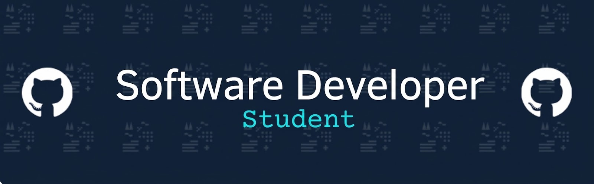

  

  <h1>Hi 👋, I'm AtamyratHalbayev</h1>
  <h3>A passionate Software Developer Student.</h3>
  
📫 How to reach me: <strong>atamyrathalbayew0@gmail.com</strong>

<table width="100%">
  <tr>
    <td width="50%" valign="top">
      <h3>Connect with me:</h3>
      
    </td>
    <td width="50%" valign="top">
      <h3>Languages and Tools:</h3>
      
      
      
    </td>
  </tr>
</table>

  <h3>GitHub Stats:</h3>
  

    
  

